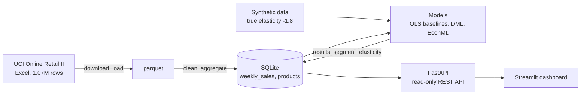
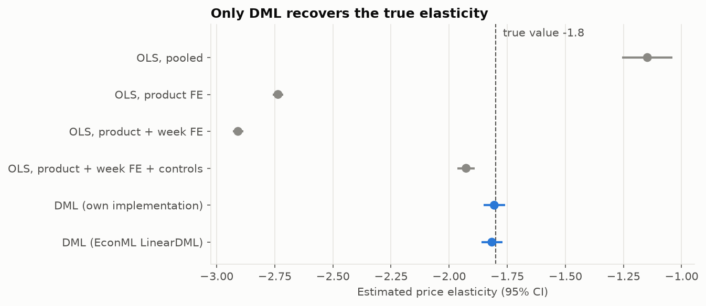
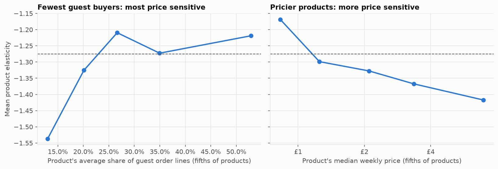

# EconoCausal

Dynamic pricing using Double Machine Learning (DML).

## Status (25 Oct 2026)

Weeks 1–2 complete: data pipeline, EDA, synthetic validation, naive baselines, own DML implementation,
EconML comparison, REST API and first dashboard. Week 3 in progress: product-level elasticities
(causal forest), robustness checks, the price optimizer, its API endpoints and the full five-page dashboard done. 155 automated tests.

- **Validated:** on synthetic data with a known elasticity of −1.8, DML estimates **−1.806**; every naive
  OLS method misses (−1.15 to −2.91) with confidence intervals that exclude the true value.
- **Result:** on 126,672 real product-weeks, a 1% price increase lowers weekly units sold by about
  **1.28%** (DML, 95% CI 1.23%–1.32%). The best naive regression overstates this at 1.53%.
- **Robust:** a placebo with shuffled prices gives −0.001, a random fake confounder changes nothing, and
  random halves of the data give −1.23 to −1.27.

## Problem

A retailer wants to know how demand for a product changes when its price changes,
i.e. the **price elasticity of demand**. Once we know the elasticity, we can pick
prices that improve revenue or profit.

The catch is that prices in historical data are not set randomly. Stores raise prices
when demand is already high (holidays, trending products) and discount when it is low.
If we just regress sales on price, the model mixes up "price affects demand" with
"demand affects price", and the elasticity comes out biased (usually it looks like
customers are less price sensitive than they really are).

This project uses **Double Machine Learning** to estimate the causal effect of price on
demand while controlling for these confounders, and then uses the estimates to
recommend prices.

- Problem statement, causal diagram and assumptions: [docs/problem_statement.md](docs/problem_statement.md)
- Week-wise plan and milestones: [docs/roadmap.md](docs/roadmap.md)
- Mid Review checklist and viva notes: [docs/mid_review.md](docs/mid_review.md), [docs/viva_notes.md](docs/viva_notes.md)
- Papers, libraries and data sources: [docs/references.md](docs/references.md)

## Approach

| # | Step | Status |
|---|------|--------|
| 1 | Clean transaction data and aggregate it to product x week level | Done |
| 2 | Explore price variation, seasonality and demand patterns (EDA) | Done |
| 3 | Synthetic dataset with a known elasticity, to check which methods recover it | Done |
| 4 | Baselines: naive OLS on log(price) vs log(quantity) | Done |
| 5a | DML, own implementation with cross-fitting | Done |
| 5b | EconML `LinearDML` for comparison | Done |
| 5c | Elasticity by category | Done |
| 5d | Causal forest for product-level elasticities | Done |
| 6 | Robustness checks (placebo treatment, random common cause, data subsets) | Done |
| 7 | Price optimizer that maximises expected profit under business constraints | Done |
| 8 | FastAPI backend + SQLite database + Streamlit dashboard | Done |
| 9 | Docker, CI and online deployment | Week 4 |

## Architecture



| Folder | Contents |
|--------|----------|
| `src/econocausal/data/` | download, load, clean, weekly panel, database |
| `src/econocausal/` | `simulate.py` (synthetic data), `baselines.py`, `crossfit.py`, `dml.py`, `models.py` (EconML), `run_dml.py` |
| `api/` | FastAPI app |
| `app/` | Streamlit dashboard |
| `notebooks/` | EDA and the synthetic-data method comparison |
| `docs/` | problem statement, data dictionary, findings, design notes, progress, viva notes |
| `reports/` | figures and result tables |
| `tests/` | 155 tests (pytest) |

## Data

- [Online Retail II (UCI Machine Learning Repository)](https://archive.ics.uci.edu/dataset/502/online+retail+ii):
  around 1M transactions from a UK online retailer, 2009-2011.
- A synthetic dataset generated in this repo with a known true elasticity (−1.8) and the same kinds of
  confounding as the real data, used to check which methods recover the true value.
  Design and validation: [docs/synthetic_data.md](docs/synthetic_data.md)

Raw data is not committed to the repo. To get it:

```bash
python -m econocausal.data.download   # download and extract the Excel file
python -m econocausal.data.load       # convert it to parquet for fast loading
python -m econocausal.data.build      # clean, build the weekly panel, save to SQLite
```

The build step creates `data/econocausal.db` with three tables: `weekly_sales`
(product x week panel used for modelling), `products` (one row per product) and
`cleaning_log` (rows removed by each cleaning step).

Column descriptions and data quality notes: [docs/data_dictionary.md](docs/data_dictionary.md)

## Early findings (EDA)

- Prices change within products in about a third of weeks (typical swing ±28%), enough to estimate elasticities.
- Demand peaks in Oct–Nov while prices dip, and prices rise in December: season affects both.
- One-off buyers without a customer ID pay about 2x the usual price, so customer mix drives weekly prices.
- The naive price slope moves from −0.67 (pooled) to about −1.5 (within product) depending on the
  controls, which is why Double ML is needed.

Details: [docs/eda_findings.md](docs/eda_findings.md) · notebook: [notebooks/01_eda.ipynb](notebooks/01_eda.ipynb)

## Baselines

Naive log-log OLS (`python -m econocausal.baselines`). On the synthetic data the true elasticity is −1.8.

| Method | Synthetic | Real |
|--------|----------:|-----:|
| Pooled, no controls | −1.15 | −0.67 |
| Product fixed effects | −2.74 | −1.54 |
| Product + week fixed effects | −2.91 | −1.60 |
| Product + week FE + guest/UK share | −1.93 | −1.53 |

None of them recovers the true value on synthetic data, and their confidence intervals exclude it.
Full table: [reports/baseline_results.csv](reports/baseline_results.csv)

## Double ML (own implementation)

[`src/econocausal/dml.py`](src/econocausal/dml.py): product fixed effects removed by demeaning,
LightGBM nuisance models cross-fitted over folds split by product, residual-on-residual final stage,
standard errors clustered by product.

| Synthetic setting (true value −1.8) | DML estimate | 95% CI |
|-------------------------------------|-------------:|--------|
| Default | **−1.806** | −1.851 to −1.760 |
| Elasticity varies by category (average −1.8) | **−1.806** | −1.871 to −1.741 |
| Hidden confounder (assumption broken) | +0.22 | fails, as expected |

The best naive baseline on the same data gives −1.93 (CI −1.96 to −1.89), which excludes the true value.
EconML's `LinearDML` with the same inputs gives −1.816 (−1.861 to −1.771).
Comparison notebook: [notebooks/02_dml_synthetic.ipynb](notebooks/02_dml_synthetic.ipynb)



## First results on real data

`python -m econocausal.run_dml`

| Method | Elasticity | 95% CI |
|--------|-----------:|--------|
| Best naive baseline (product + week FE + controls) | −1.53 | −1.58 to −1.48 |
| **DML (own implementation)** | **−1.28** | −1.32 to −1.23 |
| DML (EconML LinearDML) | −1.37 | −1.40 to −1.35 |

A 1% price increase lowers weekly units by about 1.3% on average. As on the synthetic data, the
linear baseline overstates price sensitivity, because the guest-buyer price step is not linear.

The two DML versions differ because the own implementation removes each product's average residual a
second time after the ML step and EconML does not. Without that step the own implementation gives
−1.368, matching EconML; the step is needed for a true within-product estimate on this unbalanced panel
(see the note in [`models.py`](src/econocausal/models.py)).

**By category** (own DML; one set of nuisance models, separate final stage per category):

| Category | Elasticity | 95% CI | Products |
|----------|-----------:|--------|---------:|
| garden | −1.57 | −1.78 to −1.36 | 38 |
| candles_lighting | −1.53 | −1.66 to −1.39 | 157 |
| bags | −1.37 | −1.55 to −1.18 | 94 |
| other | −1.29 | −1.36 to −1.22 | 699 |
| stationery_cards | −1.28 | −1.44 to −1.12 | 168 |
| home_decor | −1.26 | −1.37 to −1.15 | 249 |
| kitchen_dining | −1.22 | −1.35 to −1.09 | 258 |
| toys_kids | −1.18 | −1.48 to −0.88 | 59 |
| christmas | −1.11 | −1.31 to −0.91 | 60 |
| jewellery | −0.96 | −1.20 to −0.72 | 71 |
| easter | −0.90 | −1.25 to −0.55 | 24 |

Every category is price sensitive. Jewellery and Easter items are the least elastic, though their
intervals are wide because they have few products. Full results:
[reports/category_elasticities_real.csv](reports/category_elasticities_real.csv)

**By product** ([`forest.py`](src/econocausal/forest.py)): a causal forest (econml's generalized random
forest) fitted on the same cross-fitted DML residuals, with product-level effect modifiers: category,
typical price, and average guest and UK shares. Every product gets an elasticity with a 95% interval.

- 1,877 products; median −1.31, 10th–90th percentile −1.64 to −0.98; 99.9% have an interval below zero.
- Individual intervals are wide (median width 0.56), so the forest is most useful for the *pattern*.
- The main drivers are the product's **share of guest buyers** (importance 0.61) and its **price level**
  (0.26); category adds little once these are known.
- Products bought almost only by registered (mostly wholesale) customers are the most price sensitive
  (about −1.54), and more expensive products are more price sensitive (−1.17 for the cheapest fifth,
  −1.42 for the most expensive).



**Pricing** ([docs/pricing.md](docs/pricing.md), `python -m econocausal.optimize`): profit-maximising price
per product from its elasticity, within ±20% of the current price and a 20% minimum margin. Unit cost is
not in the data and is assumed at 60% of the current price.

| | Current | Recommended |
|---|---:|---:|
| Products with a price rise | – | 1,637 of 1,637 (1,630 at the +20% limit) |
| Weekly revenue | £120,097 | £114,635 (−4.5%) |
| Weekly profit | £48,039 | £57,300 (+19.3%) |

With elasticities around −1.3, the profit-maximising markup is far above today's prices, so the price
limit decides. The direction holds for any assumed cost share of 50% or more; the size of the profit gain
depends on it (+11% at 50%, +33% at 70%).

**Robustness** ([docs/robustness.md](docs/robustness.md), `python -m econocausal.robustness`): all checks pass.

| Check | Estimate | Expected |
|-------|---------:|----------|
| Placebo: prices shuffled within each product | −0.001 | about 0 |
| Random noise added as a confounder | −1.276 | about −1.275 |
| Random halves of the products (3 runs) | −1.23 to −1.27 | about −1.275 |

Notebook: [notebooks/03_heterogeneity.ipynb](notebooks/03_heterogeneity.ipynb) · all product estimates:
[reports/product_elasticities_real.csv](reports/product_elasticities_real.csv). The API's
`/products/{stock_code}/elasticity` now returns the product-level estimate.

## Tech stack

Python, pandas, scikit-learn, LightGBM, EconML, FastAPI, SQLite (SQLAlchemy), Streamlit, pytest.

## Setup

Requires Python 3.12 or newer (developed on Python 3.14).

```bash
python -m venv .venv
# Windows
.venv\Scripts\activate
# macOS / Linux
source .venv/bin/activate

pip install -r requirements.txt
pip install -e .
```

## How to run

**1. Build the data and the results** (once; the download is about 46 MB):

```bash
python -m econocausal.data.download   # download Online Retail II
python -m econocausal.data.load       # Excel -> parquet
python -m econocausal.data.build      # clean, weekly panel, SQLite
python -m econocausal.baselines       # naive OLS baselines
python -m econocausal.run_dml         # DML estimates (about 3 minutes)
```

**2. Start the API** (terminal 1):

```bash
uvicorn api.main:app --port 8000
```

Interactive API docs: http://localhost:8000/docs

| Endpoint | Returns |
|----------|---------|
| `GET /health` | status and available tables |
| `GET /categories` | categories with product counts and revenue |
| `GET /products?category=&search=&limit=&offset=` | products, best sellers first |
| `GET /products/{stock_code}` | one product's summary |
| `GET /products/{stock_code}/sales` | weekly price, units, revenue, guest share |
| `GET /products/{stock_code}/elasticity` | the product's elasticity (product-level from the causal forest, else its category) |
| `GET /elasticity?dataset=real\|synthetic` | average elasticity from every method |
| `GET /elasticity/categories` | elasticity per category |
| `POST /optimal-price` | best price for a product under given rules (max change, min margin, cost share, profit or revenue) |
| `POST /simulate` | expected units, revenue and profit at up to 50 candidate prices, with a range from the elasticity's 95% CI |
| `GET /recommendations?category=&reason=&sort=` | stored catalogue-wide recommendations, largest profit gain first |

Example (Command Prompt or bash; the easiest way is the **Try it out** button on http://localhost:8000/docs):

```bash
curl -X POST http://localhost:8000/optimal-price -H "Content-Type: application/json" -d "{\"stock_code\": \"22386\"}"
```

All request bodies are validated (ranges, list sizes, allowed values, unknown fields rejected), and all
SQL is parameterised; the API never writes to the database.

**3. Start the dashboard** (terminal 2):

```bash
streamlit run app/streamlit_app.py
```

Opens at http://localhost:8501. It reads everything from the API (set `ECONOCAUSAL_API` if the API
runs elsewhere).

| Page | What it shows |
|------|---------------|
| Overview | headline elasticity; naive OLS vs DML on real and synthetic data |
| Elasticity | elasticity by category, distribution of product elasticities, most and least price-sensitive products |
| Products | search any product; weekly price and units history; its elasticity |
| Price simulator | move a price slider and see expected units, revenue and profit (with the elasticity's uncertainty band) |
| Optimizer | recommended price for a product under your own rules (price limit, margin, cost share, profit or revenue), plus the whole catalogue |

The selected product stays selected when switching between pages.

**Tests:** `pytest`

## Progress

| Week | Focus | Status |
|------|-------|--------|
| 1 | Setup, data pipeline, EDA, synthetic data, naive baselines | Done ([notes](docs/progress/week1.md)) |
| 2 | DML (manual + EconML), API, first dashboard | Done ([notes](docs/progress/week2.md)) |
| 3 | Heterogeneous effects, robustness checks, price optimizer | Not started |
| 4 | Full dashboard, Docker, CI, deployment | Not started |

## Author

Aman Singh Dadsena, Data Science & ML Intern, Infotact Solutions
