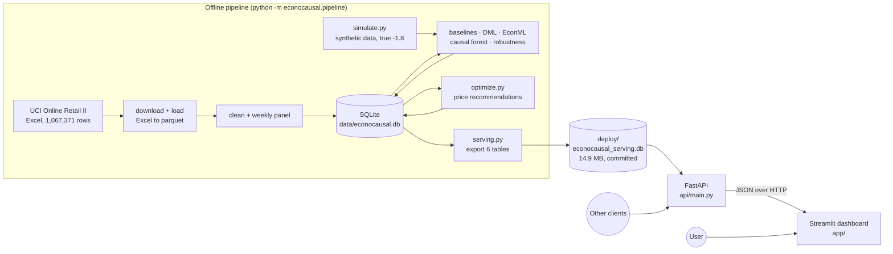
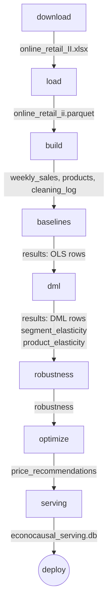
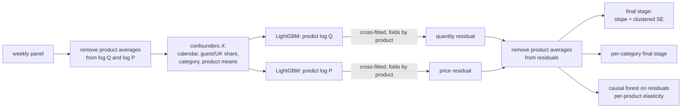
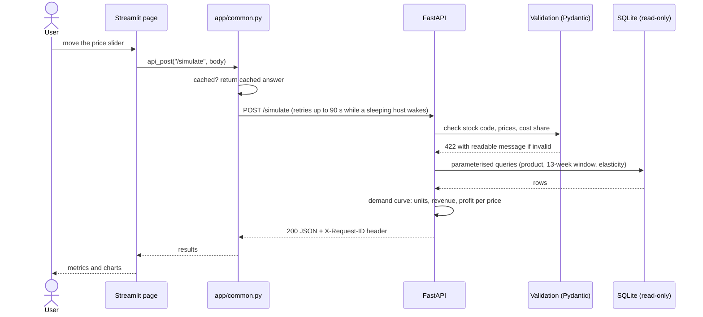
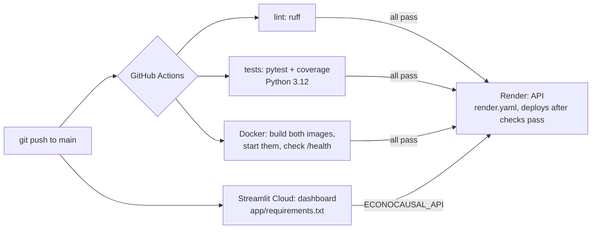

# Architecture

EconoCausal has three parts: an **offline pipeline** that turns raw transactions into elasticity
estimates and price recommendations, a **read-only REST API** that serves those results, and a
**dashboard** that reads everything through the API.

## 1. System overview

The heavy work (machine learning on 126,672 product-weeks) happens once, offline. The API only reads
stored results and does light calculations (pricing formulas), so it needs no ML libraries and
starts quickly.

## 2. Offline pipeline

| Step | Module | What it does | Time |
|------|--------|--------------|-----:|
| download | `data/download.py` | Downloads and unzips the dataset; skipped if present. Writes to temporary files, so an interrupted download never looks finished. | – |
| load | `data/load.py` | Reads both Excel sheets, standardises columns and types, saves parquet. | ~4 min |
| build | `data/clean.py`, `data/panel.py`, `data/db.py` | Six cleaning rules (logged), product x week aggregation with median price, features, filters (≥ 30 weeks, ≥ 5 prices). | ~15 s |
| baselines | `baselines.py` | Four OLS specifications with exact two-way fixed effects, on synthetic and real data. | ~10 s |
| dml | `run_dml.py` → `dml.py`, `crossfit.py`, `models.py`, `forest.py` | Own DML (shared cross-fitted residuals) for the average, per category and, via the causal forest, per product; EconML as a check; synthetic validation. | ~4 min |
| robustness | `robustness.py` | Placebo, random common cause, data subsets. | ~3 min |
| optimize | `optimize.py` | Profit-maximising price per product within business rules; cost sensitivity. | ~2 s |
| serving | `serving.py` | Deterministic export of the six tables the API reads. | ~1 s |

All model steps use fixed seeds; a full rebuild reproduces every committed result file exactly.

## 3. Inside the DML estimator

Steps 1–3 (`dml.residualize`) are the expensive part and run once; the overall estimate, the
category estimates and the causal forest all reuse the same residuals.

## 4. Request flow

Every request is logged with method, path, status, duration and a request ID. Unexpected errors return
only the request ID; the details go to the log.

## 5. Database

SQLite file `data/econocausal.db`, built by the pipeline (not in git).

| Table | Rows | Key | Written by | Contents |
|-------|-----:|-----|------------|----------|
| `weekly_sales` | 126,672 | stock_code, week_start | build | product x week panel: price, quantity, revenue, customer mix, calendar features |
| `products` | 1,877 | stock_code | build | one row per product: description, category, price range, totals |
| `cleaning_log` | 6 | step | build | rows removed by each cleaning rule |
| `results` | 12 | dataset, method | baselines, dml | average elasticity per method (OLS x 4, own DML, EconML) on real and synthetic data |
| `segment_elasticity` | 11 | dataset, method, segment, value | dml | elasticity per category |
| `product_elasticity` | 1,877 | dataset, method, stock_code | dml | causal-forest elasticity per product |
| `robustness` | 6 | dataset, check | robustness | refutation results |
| `price_recommendations` | 1,637 | stock_code | optimize | recommended price and expected units, revenue and profit |

Results are written with an "upsert": re-running a step replaces its own rows instead of adding
duplicates. The API reads six of these tables from the serving copy (`cleaning_log` and `robustness`
are not served).

## 6. API

`api/main.py` (FastAPI) with request and response models in `api/schemas.py`. Read-only: the API never
writes to the database.

| Group | Endpoints |
|-------|-----------|
| Status | `GET /health` |
| Products | `GET /categories`, `GET /products`, `GET /products/{code}`, `GET /products/{code}/sales` |
| Elasticity | `GET /elasticity`, `GET /elasticity/categories`, `GET /elasticity/products`, `GET /products/{code}/elasticity` |
| Pricing | `POST /optimal-price`, `POST /simulate`, `GET /recommendations` |

Safety measures:

- all SQL is parameterised; sort orders come from fixed whitelists, never from user text
- every request field has a type, range and size limit; NaN and infinity are rejected
- unknown fields are rejected; stock codes may only contain letters and digits
- `/simulate` only accepts prices between 20% and 500% of the current price
- error responses never contain internal details

## 7. Dashboard

`app/streamlit_app.py` defines five pages (in `app/views/`); `app/common.py` holds the API client,
chart style and the product picker shared by all pages.

| Page | Main API calls |
|------|----------------|
| Overview | `/elasticity` (real and synthetic), `/products` |
| Elasticity | `/elasticity/categories`, `/elasticity/products` |
| Products | `/products`, `/products/{code}`, `/products/{code}/sales`, `/products/{code}/elasticity` |
| Price simulator | `/optimal-price`, `/simulate` |
| Optimizer | `/optimal-price`, `/recommendations` |

API responses are cached for five minutes; the selected product is kept when switching pages.

## 8. Deployment and CI

| Environment | API | Dashboard | Database |
|-------------|-----|-----------|----------|
| Local | `uvicorn api.main:app` | `streamlit run app/streamlit_app.py` | full `data/econocausal.db` |
| Docker | `Dockerfile` (slim, non-root) | `Dockerfile.dashboard` | mounted read-only at `/app/data` |
| Hosted | Render free web service | Streamlit Community Cloud | committed serving copy |

Details: [deployment.md](deployment.md).

## 9. Code map

| Folder / module | Responsibility |
|-----------------|----------------|
| `src/econocausal/data/` | download, load, clean, weekly panel, database helpers |
| `src/econocausal/simulate.py` | synthetic panel with known elasticity |
| `src/econocausal/baselines.py` | naive OLS with exact fixed effects |
| `src/econocausal/crossfit.py` | product-grouped folds and out-of-fold predictions |
| `src/econocausal/dml.py` | own DML estimator: residuals, final stage, per segment |
| `src/econocausal/models.py` | EconML LinearDML with the same inputs |
| `src/econocausal/forest.py` | causal forest on DML residuals, per-product elasticity |
| `src/econocausal/robustness.py` | refutation tests |
| `src/econocausal/optimize.py` | demand curve, pricing rules, recommendations |
| `src/econocausal/serving.py` | deterministic export for the API |
| `src/econocausal/pipeline.py` | one-command pipeline |
| `src/econocausal/log.py`, `paths.py`, `viz.py` | logging, paths, chart style for notebooks |
| `api/` | REST API and schemas |
| `app/` | dashboard |
| `tests/` | 200 tests (unit, API, pipeline, end-to-end on small data) |

## 10. Testing strategy

| Level | Examples |
|-------|----------|
| Unit | cleaning rules, fold assignment, final-stage standard error vs statsmodels, Lerner price vs brute-force search |
| Statistical | DML recovers −1.8 on synthetic data and beats every baseline; fails under hidden confounding as it should; causal forest recovers category elasticities |
| API | every endpoint, validation errors, SQL-injection strings, hidden internal errors, logging |
| Integration | data build on a small raw table; serving database gives the same answers as the full one; export is byte-for-byte deterministic |
| End to end | full pipeline rebuild from raw data reproduces all committed results (run manually; about 11 minutes) |
| CI | lint, tests with coverage, Docker build and health check on every push |
