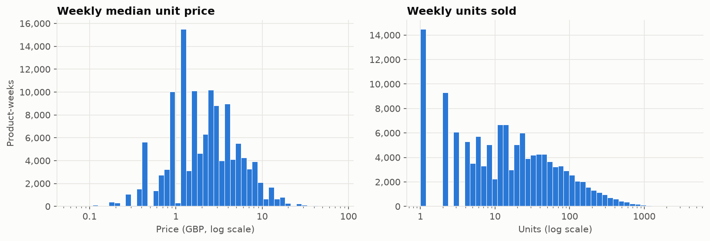
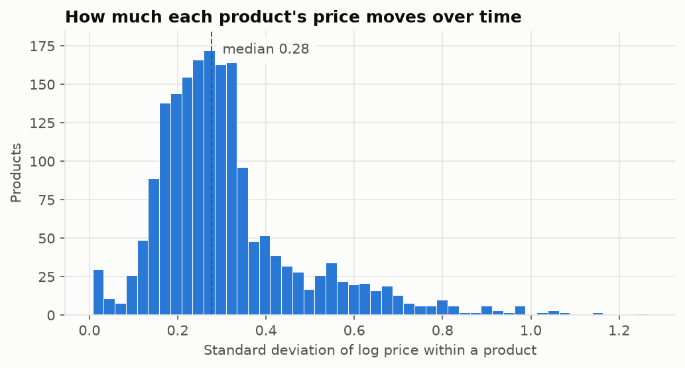
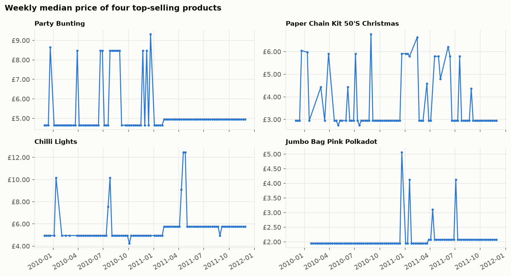
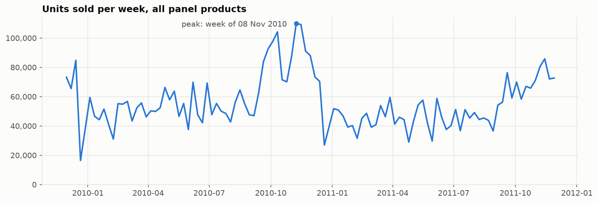
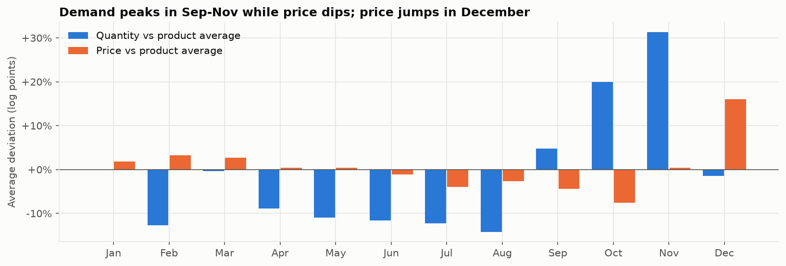
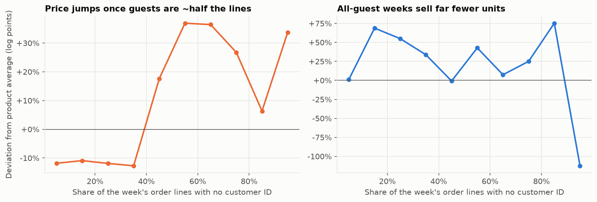
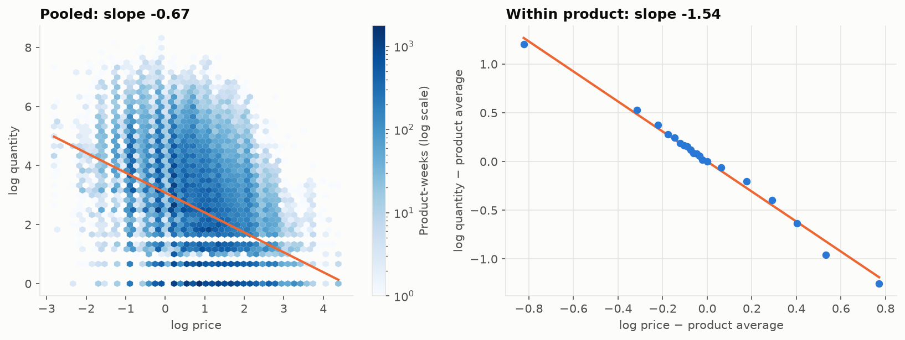

# EDA Findings

Notebook: [`notebooks/01_eda.ipynb`](../notebooks/01_eda.ipynb) · Figures: [`reports/figures/`](../reports/figures/)

Data: weekly product panel (`weekly_sales`), **126,672 product-weeks, 1,877 products, 103 weeks**
(30 Nov 2009 – 28 Nov 2011), 5.8M units and £10.3M revenue.

## Summary

1. Prices do move within products, enough to estimate elasticities.
2. Demand is strongly seasonal, and price moves with the season, so season is a confounder.
3. Customer mix (guest vs registered buyers) drives the weekly price and also affects quantity.
   It is a second confounder.
4. The naive price slope changes from **−0.67** to about **−1.5** depending on what is controlled
   for. This sensitivity is the reason to use Double ML.

## 1. Distributions

- Weekly median price: median **£2.10**, middle 50% between £1.25 and £3.76.
- Weekly units: median **13**, but a long right tail (95th percentile 193, max 4,115).
- Both are right-skewed and look close to normal on a log scale, which supports the log-log demand model.
- Prices cluster at fixed price points (the most common are £1.25, £0.85, £2.95, £0.42 and £1.65),
  which is why the histogram has gaps.

## 2. Price variation within products

| Measure | Value |
|---------|------:|
| Share of log-price variance that is within products | 13.3% |
| Median within-product SD of log price | 0.28 (about ±28%) |
| Products with SD of log price above 0.15 | 90.2% |
| Weeks where the price differs from the previous sale week | 36.8% |

Most of the price variation in the data is *between* products (cheap vs expensive items). Only
13% is within products, but that is still a typical swing of about ±28% for a product, and
prices change in more than a third of weeks. That is enough to estimate own-price elasticities.

Prices move between a small number of **fixed levels** (e.g. Party Bunting at £4.65 or £8.47)
rather than drifting smoothly. Section 4 explains why.

## 3. Seasonality

- Demand builds from September and peaks in **October–November**: the busiest week was
  8 Nov 2010 (about 110,000 units). Wholesale customers stock up before Christmas.
- The quietest weeks are around Christmas (week of 21 Dec 2009: 16,431 units; 20 Dec 2010: 26,948),
  when the business winds down.

Measured against each product's own average:

| Month | Quantity | Price |
|-------|---------:|------:|
| Feb–Aug | −9% to −14% (most months) | −4% to +3% |
| Oct | +20% | **−8%** |
| Nov | **+31%** | 0% |
| Dec | −2% | **+16%** |

Price is not constant over the year: it is lowest in Sep–Oct, when demand is rising, and highest in
December, when big orders stop. **Season affects both price and demand, so it must be controlled for.**

## 4. Customer mix: the retail price tier

- 22.5% of cleaned order lines have no customer ID. These lines are priced at a median of
  **1.98x** the product's usual price. They are one-off buyers paying the retail price, while
  registered (mostly wholesale) customers pay the lower price.
- The weekly price is a median over order lines, so it **jumps to the retail tier once guests are about
  half of a product's lines** in that week. This explains the fixed price levels seen in section 2.
- Within a product, the guest share correlates **0.51** with price.
- Weeks bought only by guests (13% of product-weeks) sell far fewer units (about −112 log points vs the
  product average). 44% of product-weeks have no guest lines at all.

**Consequence:** much of the week-to-week price variation comes from *who* is buying, not from the shop
changing its prices. `guest_share` was added to the panel as a control variable, and the DML models must
include it. Otherwise, part of the "price effect" would really be a customer-mix effect.

## 5. Demand curves

Plain OLS slopes of log quantity on log price (not causal estimates):

| Specification | Slope |
|---------------|------:|
| Pooled, no controls | −0.67 |
| Within product (each product vs its own average) | −1.54 |
| Within product + week effects | −1.59 |
| Within product + week effects + guest share | −1.52 |

- The **pooled slope is much flatter** because it compares different products: cheap products are also the
  popular ones, so "low price" and "high quantity" partly reflect product differences.
- Comparing each product with itself roughly **doubles** the slope.
- Adding week effects and guest share moves it further. Each new control changes the answer, which shows
  confounding is real. These linear controls are also too simple for the nonlinear seasonal and
  customer-mix effects seen above.

This is exactly the setting for **Double ML**: flexible ML models remove the effect of the confounders from
both price and quantity, and the elasticity is estimated from what is left.

## 6. Categories

The keyword categories cover 63% of product-weeks; 37% are `other`. The largest named groups are kitchen &
dining, home decor and stationery & cards. Jewellery has the highest median price (£3.75) and lowest
weekly units (median 2). Christmas products have the highest median weekly units (31.5).

## Implications for modelling

- **Outcome / treatment:** `log_quantity` and `log_price` (supported by the distributions).
- **Controls (X):** product identity/category, week of year, weeks to Christmas, peak season, bank holidays,
  year, `guest_share`, `uk_share`.
- **Watch out:** `n_invoices` and `n_customers` are partly *results* of the price (more orders when cheaper),
  so they should **not** be used as controls. Controlling for them would hide part of the true effect.
- **Expected range:** naive within-product slopes are around −1.5. The DML estimate will be compared against
  this and against the known answer on synthetic data (Day 6).
- **Limitation:** weeks with no sales are not in the panel, so very high-price weeks with zero demand are
  missing. This may make demand look slightly less elastic than it is.
