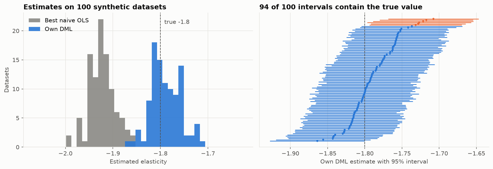

# Evaluation Results

How well the elasticity estimates work, measured where the true answer is known (synthetic data) and
checked where it is not (real data).

| Question | Evidence | Answer |
|----------|----------|--------|
| Does DML find the true elasticity? | single synthetic run; 100-dataset study | yes: −1.806 vs −1.8; average −1.789 over 100 datasets |
| Are its 95% intervals honest? | 100-dataset coverage study | yes: 94% coverage, consistent with 95% |
| Are its standard errors right? | reported SE vs spread of estimates | yes: 0.033 vs 0.031 |
| Do naive methods work? | same studies | no: best OLS covers the truth in 0 of 100 datasets |
| Is the real-data result stable? | refutation tests | yes: placebo ≈ 0, unchanged with a noise confounder or on half the data |
| Can it fail? | hidden-confounder scenario | yes, if a confounder is not in the data (main limitation) |

## 1. Single synthetic dataset

300 products x 104 weeks, true elasticity −1.8 ([synthetic_data.md](synthetic_data.md)).
Notebook: [02_dml_synthetic.ipynb](../notebooks/02_dml_synthetic.ipynb).

| Method | Estimate | 95% CI | Contains −1.8 |
|--------|---------:|--------|:-------------:|
| OLS, pooled | −1.15 | −1.26 to −1.04 | no |
| OLS, product FE | −2.74 | −2.76 to −2.71 | no |
| OLS, product + week FE | −2.91 | −2.93 to −2.89 | no |
| OLS, product + week FE + controls | −1.93 | −1.96 to −1.89 | no |
| **Own DML** | **−1.806** | −1.851 to −1.760 | **yes** |
| EconML LinearDML | −1.816 | −1.861 to −1.771 | yes |

## 2. Coverage study (100 synthetic datasets)

Code: [`evaluation.py`](../src/econocausal/evaluation.py) · run: `python -m econocausal.evaluation` ·
results: [`coverage_study_summary.csv`](../reports/coverage_study_summary.csv),
[`coverage_study_runs.csv`](../reports/coverage_study_runs.csv)

A single run can be lucky. A 95% interval should contain the true value in about 95% of repeated samples,
so the generator was run with 100 different seeds (150 products x 104 weeks each, true elasticity −1.8
every time), and both the own DML and the best naive OLS were fitted on each dataset.

| | Own DML | Best naive OLS |
|---|---:|---:|
| Datasets | 100 | 100 |
| **Coverage of the 95% interval** | **94%** | **0%** |
| 95% interval for the coverage itself (Wilson) | 87.5% – 97.2% | 0.0% – 3.7% |
| Mean estimate | −1.789 | −1.923 |
| Bias | +0.011 | −0.123 |
| RMSE | 0.033 | 0.126 |
| Mean reported standard error | 0.033 | 0.027 |
| Standard deviation of the estimates | 0.031 | 0.027 |

**Reading the results**

- **DML intervals are honest.** 94 of 100 contain −1.8. The 95% target lies inside the uncertainty
  range for the coverage (87.5%–97.2%), so the result is consistent with exact 95% coverage.
- **DML standard errors are well calibrated.** The average reported standard error (0.033) matches how
  much the estimates actually vary between datasets (0.031). The clustered standard error in
  `dml.final_stage` therefore measures the real uncertainty.
- **OLS is confidently wrong.** Its intervals are just as narrow, but every one of them is in the wrong
  place: the bias (−0.123) is about four and a half standard errors. More data would make the intervals
  narrower, not more correct.
- **DML has a small bias.** On average it is 0.011 less negative than the truth (about one third of a
  standard error), and all 6 intervals that miss do so on that side. This is the usual effect of ML
  nuisance models removing slightly too little of the confounding, and it is small next to the OLS bias.

The study uses lighter LightGBM settings and half as many products as the main analysis to keep 100 runs
to about 15 minutes, so the main analysis (more trees, more data) should be at least as accurate.

## 3. Real data

The true elasticity is unknown, so the checks test stability rather than accuracy
([robustness.md](robustness.md)).

| Check | Estimate | Expected | Passed |
|-------|---------:|----------|:------:|
| Main result (own DML) | −1.275 | – | – |
| Placebo: prices shuffled within each product | −0.001 | about 0 | yes |
| Random noise added as a confounder | −1.276 | within 0.1 of −1.275 | yes |
| Random half of the products (3 runs) | −1.231 to −1.270 | within 0.1 of −1.275 | yes |

Out-of-fold R² of the nuisance models: 0.32 for quantity and 0.47 for price. About half of the
within-product price variation is explained by season and customer mix; the elasticity is estimated from
the rest.

## 4. When the method fails

With an unobserved confounder (`simulate_panel(hidden_confounding=1.0)`), DML estimates +0.22 instead of
−1.8, and its interval excludes the truth. No estimator can correct for a confounder that is not in the
data. This is the main assumption behind the real-data result: competitor prices, marketing and stock-outs
are not observed.

## 5. Software quality

| Measure | Value |
|---------|-------|
| Automated tests | 202, all passing |
| Line coverage | 84% (the remaining lines are mostly command-line wrappers run by the pipeline) |
| CI | lint, tests with coverage, Docker build and health check on every push |
| Reproducibility | a full rebuild from the raw data reproduces every committed result file exactly |
| API safety | parameterised SQL, validated inputs (ranges, sizes, no NaN/infinity), no internal details in errors |
