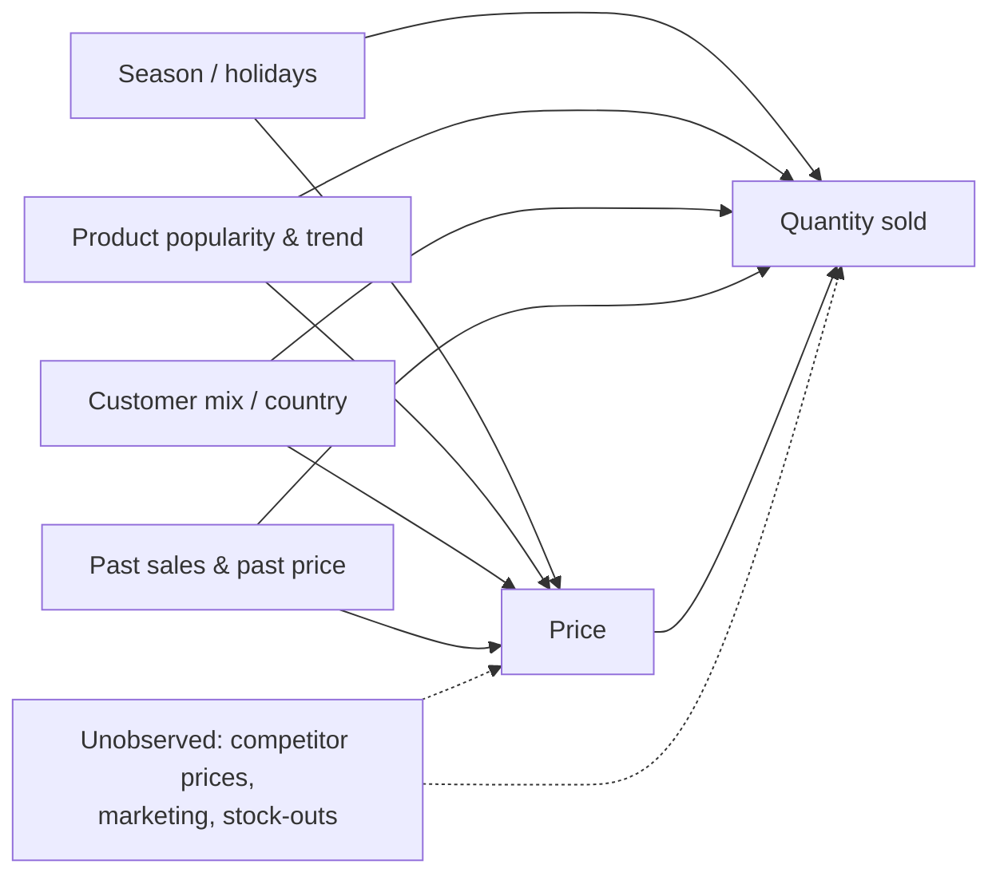

# Problem Statement

## 1. Business context

An online retailer sells a few thousand products and changes prices fairly often:
seasonal pricing, discounts on slow items, higher prices around Christmas, and
different unit prices for bulk orders. Right now these decisions are made by
rule of thumb.

The question the business actually wants answered is simple:

> **If we change the price of a product by 1%, how much will the quantity sold change?**

That number is the **price elasticity of demand**. If we know it for each product
(or group of products), we can set prices that increase revenue or profit instead of
guessing.

## 2. Objective

1. Estimate the **causal** price elasticity of demand for products in the
   Online Retail II dataset.
2. Find out how the elasticity changes across segments (product category, season,
   country).
3. Use the estimates to recommend prices that maximise expected profit, within
   realistic limits.
4. Make the results usable through an API and a dashboard.

## 3. Key definitions

| Term | Meaning in this project |
|------|-------------------------|
| Unit of analysis | one product (`StockCode`) in one week |
| Treatment `T` | log of the average unit price of the product that week |
| Outcome `Y` | log of the total quantity sold that week |
| Confounders `X` | things that affect both price and demand (time, season, product, customer mix, past sales) |
| Elasticity `θ` | % change in quantity for a 1% change in price |

Because both price and quantity are in logs, the coefficient on price is directly the
elasticity. For example, θ = -1.5 means a 1% price increase reduces quantity sold by
about 1.5%.

- |θ| > 1: **elastic**, customers react strongly to price
- |θ| < 1: **inelastic**, customers barely react

## 4. Why a simple regression is not enough

The obvious approach is to regress `log(quantity)` on `log(price)`. The problem is
that prices in historical data were **not set at random**.

- In November and December demand goes up, and the retailer also raises some prices.
  High price and high sales show up together, so the regression thinks price
  increases don't hurt sales much.
- Popular products tend to be priced higher. Again, high price appears together
  with high sales.
- Slow-moving items get discounted. Low price appears together with low sales.

In all of these cases something else (season, popularity, demand trends) is driving
**both** the price and the sales. These are **confounders**. Ignoring them biases the
elasticity, usually towards zero, which would make us think customers are less
price-sensitive than they really are and push us towards overpricing.

There is one more issue specific to this dataset: wholesale customers buying large
quantities often get a lower unit price. So in a single invoice, quantity can affect
price (bulk discount) instead of price affecting quantity. To reduce this I will use
a weekly price per product (median or typical price) instead of individual invoice
prices, and check how sensitive the results are to very large orders.

## 5. Causal diagram



- The arrow **Price → Quantity** is the effect I want to estimate.
- Every other path from Price to Quantity goes through a confounder. These are
  "back-door" paths, and they have to be blocked by controlling for the confounders.
- The dashed node `U` contains things that are **not in the data**. No method can fully
  remove bias from them, so they are listed as a limitation (section 9).

## 6. Approach: Double Machine Learning

The demand model is written as

```
Y = θ · T + g(X) + ε        (outcome equation)
T = m(X) + v                (price / treatment equation)
```

`g(X)` and `m(X)` can be complicated and nonlinear (seasonality, product effects,
interactions), so they are learned with ML models (LightGBM). The elasticity θ is the
only thing we want to interpret.

Steps:

1. Predict quantity `Y` from the confounders `X` with an ML model and take the residual
   `Ỹ = Y − ĝ(X)`.
2. Predict price `T` from the confounders `X` with an ML model and take the residual
   `T̃ = T − m̂(X)`.
3. Regress `Ỹ` on `T̃`. The slope is the estimate of θ.
4. Use **cross-fitting**: train the models on some folds and compute residuals on the
   held-out fold, so overfitting does not leak into the estimate.

The intuition: after removing everything the confounders can explain, what is left of
the price is "unexpected" price variation, and we look at how sales respond to it.

Extensions:

- **Heterogeneous effects** θ(X) using `CausalForestDML`, to get a separate elasticity
  for each category, season or country.
- **Price optimisation**: profit = (p − c) · q(p). With constant elasticity θ < −1,
  the profit-maximising price is `p* = c · θ / (1 + θ)`. In practice I will search over
  a limited range (for example ±20% of the current price) instead of trusting the
  formula blindly.

## 7. Assumptions

| Assumption | What it means here | How I will check it |
|------------|--------------------|---------------------|
| No unobserved confounding | all important drivers of both price and demand are in `X` | cannot be proven; robustness tests and an honest limitations section |
| Overlap / positivity | prices actually vary for similar products in similar weeks | look at price variation per product during EDA; drop products with almost constant prices |
| No interference | the price of one product does not change demand for another | probably violated for substitute products; noted as a limitation |
| Correct functional form for θ | elasticity is constant within a segment (log-log model) | compare with segment-level estimates |

## 8. Data

- **Main dataset:** Online Retail II (UCI), about 1M transactions from a UK online
  retailer between Dec 2009 and Dec 2011. Columns: `Invoice`, `StockCode`,
  `Description`, `Quantity`, `InvoiceDate`, `Price`, `Customer ID`, `Country`.
- **Synthetic dataset:** generated in this project with a known true elasticity
  (for example −1.8) and deliberate confounding. Since the true answer is known,
  this is how I can test whether each method is biased or not.

## 9. Success criteria

**Model / method**

- On synthetic data, the DML estimate is close to the true elasticity and its 95%
  confidence interval contains it, while naive OLS is clearly biased.
- Over repeated simulations, the 95% interval contains the true value roughly 95% of
  the time.
- On real data, estimated elasticities are negative and in a believable range, and
  they stay stable under placebo, random-confounder and subset tests.

**Business**

- A recommended price per product with the expected change in revenue and profit,
  inside the business constraints.

**Engineering**

- Reproducible pipeline (one command rebuilds data and results).
- API endpoints and dashboard working on a deployed link.
- Tests passing in CI.

## 10. Scope and limitations

In scope:

- Weekly product-level elasticity, average and by segment
- Price recommendations for products with enough price variation
- API, database and dashboard for the results

Out of scope / limitations:

- No competitor price or marketing data, so some confounding may remain
- No real cost data, so costs are an assumption (documented in the optimizer)
- Cross-product effects (substitutes and complements) are not modelled
- Data is from one UK retailer in 2009-2011, so results may not generalise
