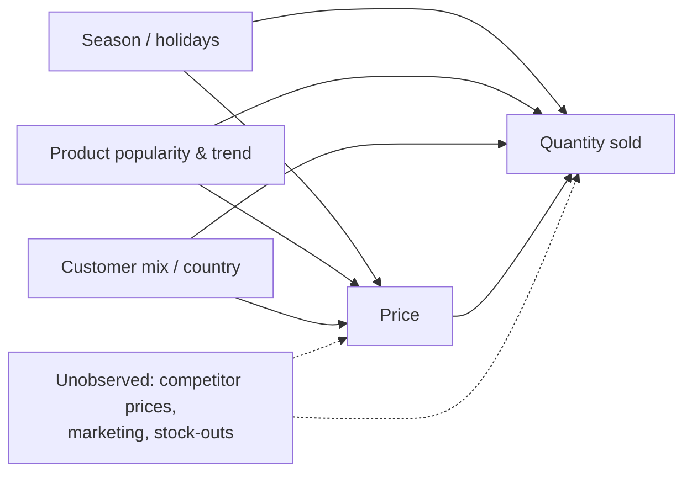

# EconoCausal: Dynamic Pricing via Double Machine Learning

**Project report**

Aman Singh Dadsena · Data Associate L1 Intern, Data Science & Machine Learning · Infotact Solutions

Code: https://github.com/AmanDadsena/econocausal

---

## Abstract

Retailers need to know how demand responds to price, but historical prices are not set at random: they move
with season, product popularity and the mix of customers buying. A plain regression of sales on price
therefore confuses the effect of price with the effect of these confounders. This project estimates the causal
price elasticity of demand for an online gift retailer using Double Machine Learning (DML), on 1,067,371
transactions from the UCI Online Retail II dataset.

The own DML implementation was validated on synthetic data where the true elasticity is known (−1.8). It
estimates −1.806, and over 100 independent datasets its 95% confidence intervals contain the true value 94%
of the time. The best naive regression contains it 0% of the time. On the real data the average elasticity is
**−1.28** (95% CI −1.32 to −1.23): a 1% price increase lowers weekly units sold by about 1.3%. A naive
regression overstates this at −1.53. Elasticities were also estimated per category and, with a causal forest,
for each of 1,877 products. Products bought mostly by wholesale customers, and more expensive products, are
the most price sensitive.

The estimates feed a price optimizer with business limits. The results are served by a REST API with a
SQLite database and a five-page dashboard, packaged with Docker and tested in continuous integration.

---

## 1. Introduction

### 1.1 Background

Pricing is one of the most direct levers a retailer has. A price that is too low gives away margin; a price that
is too high loses sales. The key quantity is the **price elasticity of demand**: the percentage change in
quantity sold for a 1% change in price. With it, a business can estimate what a price change will do to units,
revenue and profit before making the change.

Elasticity looks easy to estimate from sales history, since prices and quantities are both recorded. The
difficulty is that the data comes from a business that was already making decisions. Prices rise when demand
is high, slow items get discounted, and different customers pay different prices. High prices and high sales
appear together for reasons that have nothing to do with price causing sales. Estimating what price *causes*
requires separating these effects, which makes this a question of causal inference rather than prediction.

A model that predicts sales accurately can still give a badly wrong answer to "what happens if I change the
price?", because prediction only needs correlation.

### 1.2 Problem statement

> Using the transaction history of an online retailer, estimate how much the quantity sold changes when the
> price changes, separating the causal effect of price from confounding factors, and use the result to
> recommend prices.

### 1.3 Objectives

1. Build a reproducible data pipeline from raw transactions to a modelling dataset.
2. Identify the confounders in the data through exploratory analysis.
3. Implement Double Machine Learning and show, on data with a known answer, that it recovers the true
   elasticity where naive methods do not.
4. Estimate the elasticity on the real data: on average, per category and per product.
5. Test the stability of the result with robustness checks.
6. Turn the estimates into price recommendations within business limits.
7. Make the results usable through an API and a dashboard, with tests, Docker and continuous integration.

### 1.4 Scope

In scope: weekly product-level elasticities for products with enough price variation; price recommendations;
an API and a dashboard. Out of scope: cross-product effects (substitutes and complements), competitor
behaviour and real cost data, none of which are in the dataset. These limits are discussed in section 8.

### 1.5 Main contributions

- An own implementation of DML with product fixed effects, cross-fitting by product and clustered standard
  errors, checked against EconML and against statsmodels.
- A synthetic data generator with the same kinds of confounding as the real data, used to measure bias and
  confidence-interval coverage directly.
- The finding that customer mix (one-off buyers paying a higher retail price) drives much of the week-to-week
  price variation in this dataset, and is therefore an important confounder.
- A complete, reproducible system: one command rebuilds every result from the raw data, byte for byte.

---

## 2. Background and theory

### 2.1 Price elasticity

Demand is modelled in logs:

```
log Q = θ · log P + (other factors) + ε
```

With both variables in logs, the coefficient θ is the elasticity: θ = −1.5 means a 1% price increase lowers
quantity by about 1.5%. Demand is called **elastic** when |θ| > 1, in which case a price rise lowers revenue,
and **inelastic** when |θ| < 1, in which case a price rise raises revenue.

### 2.2 Confounding

A **confounder** is a variable that affects both the treatment (price) and the outcome (quantity). Figure 2.1
shows the confounders considered in this project. The arrow from price to quantity is the effect of interest;
every other path between them is a "back-door" path that must be blocked by controlling for the confounder.



*Figure 2.1: Causal diagram. The dashed node is not in the data and cannot be controlled for.*

If a confounder is ignored, the regression attributes part of its effect to price, and the estimate is biased.
The direction of the bias depends on the confounder, so naive estimates can be too high or too low.

### 2.3 Regression adjustment and the Frisch–Waugh–Lovell theorem

The classic remedy is to add confounders as controls in a linear regression. The Frisch–Waugh–Lovell theorem
gives a useful way to see what this does: the coefficient on price in the full regression equals the slope from
regressing the part of quantity not explained by the controls on the part of price not explained by the controls.

Linear controls, however, assume straight-line effects. In this dataset the effects are not linear. Seasonal
demand peaks sharply before Christmas, and the customer-mix effect on price is a step (section 3.4). Residual
confounding then remains even though the right variables are in the model.

### 2.4 Double Machine Learning

Double Machine Learning (Chernozhukov et al., 2018) keeps the logic of Frisch–Waugh–Lovell but replaces the
linear models with flexible machine-learning models. It uses the partially linear model:

```
Y = θ · T + g(X) + ε       (outcome equation)
T =         m(X) + v       (treatment equation)
```

where Y is log quantity, T is log price and X holds the confounders. The functions g and m may be complicated
and are learned by ML models; only θ is of interest. The procedure is:

1. Predict Y from X with an ML model, and take the residual Ỹ = Y − ĝ(X).
2. Predict T from X with an ML model, and take the residual T̃ = T − m̂(X).
3. Regress Ỹ on T̃. The slope is θ̂ = Σ T̃·Ỹ / Σ T̃².

The price residual T̃ is the part of the price that the confounders cannot explain. It behaves much like a
random price change, so the response of quantity to it can be read as causal, under the assumptions in
section 2.7.

Two ingredients make this statistically valid even though ML models are biased by regularization:

**Neyman orthogonality.** The estimate depends on residuals from *both* models, so errors in either
model affect it only at second order (error × error). Imperfect ML models therefore do not carry their errors
through to θ̂ in the way a single "plug-in" model would.

**Cross-fitting.** Each observation's residual comes from a model that was trained without it. Otherwise an
overfitted model would partly fit the noise in its own training rows, the residuals would be too small and the
estimate would be biased. The data is split into K folds; models are trained on K−1 folds and predict the
remaining fold, in rotation.

### 2.5 Heterogeneous effects and causal forests

One average elasticity hides differences between products. A causal forest (Wager & Athey, 2018; Athey,
Tibshirani & Wager, 2019) extends random forests to estimate how an effect varies with characteristics X,
written θ(X). Trees split where the relationship between the price residual and the quantity residual differs
most. "Honest" trees use separate samples to choose splits and to estimate effects, which allows valid
confidence intervals.

### 2.6 From elasticity to price

With constant elasticity θ around the current price p₀ and quantity q₀, and unit cost c:

```
q(p) = q₀ · (p / p₀)^θ
π(p) = (p − c) · q(p)
```

For θ < −1, profit π has a single maximum at the inverse-elasticity (Lerner) price:

```
p* = c · θ / (1 + θ)
```

For θ ≥ −1 demand is inelastic and profit keeps rising with price, so the model alone has no finite answer.
Practical limits on the price are therefore essential.

### 2.7 Assumptions

| Assumption | Meaning in this project | How it is treated |
|------------|-------------------------|-------------------|
| No unobserved confounding | all important common drivers of price and demand are in X | cannot be proven; stated as the main limitation, with its effect measured on synthetic data |
| Overlap | prices vary among similar products in similar weeks | checked in the data analysis; products without price variation are excluded |
| No interference | one product's price does not change demand for another | probably violated for close substitutes; noted as a limitation |
| Constant elasticity (locally) | the log-log form holds near observed prices | price changes limited to ±20% |
