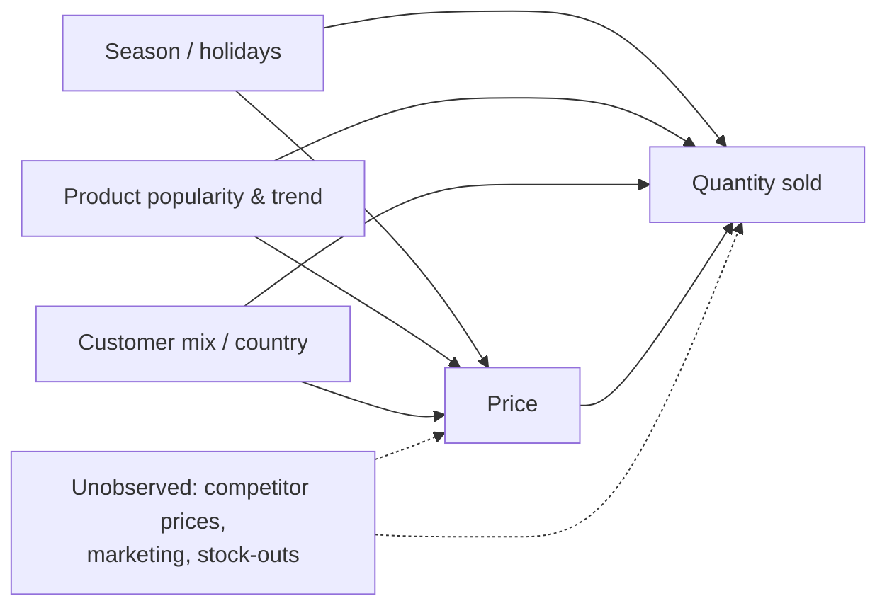
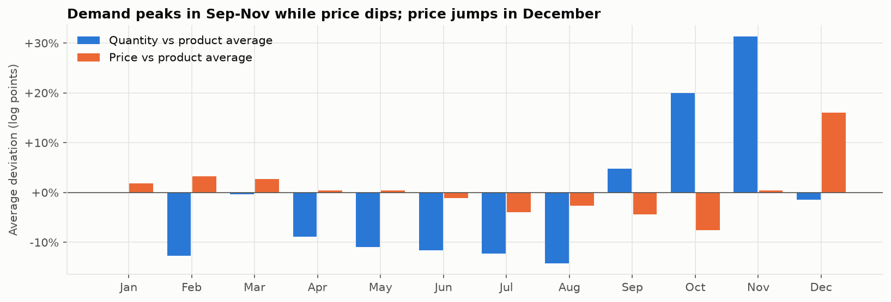
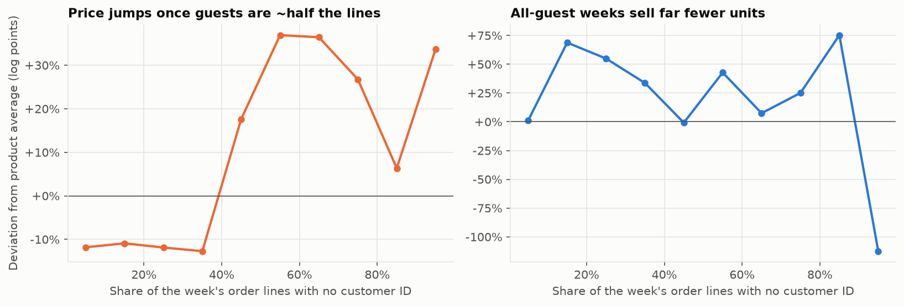
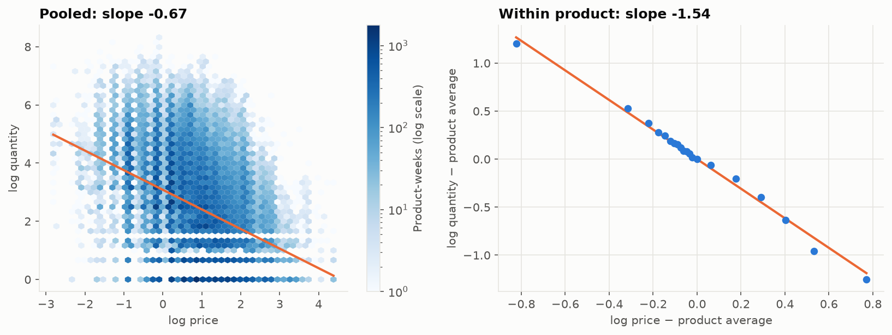

# EconoCausal: Dynamic Pricing via Double Machine Learning

**Project report**

Aman Singh Dadsena · Data Associate L1 Intern, Data Science & Machine Learning · Infotact Solutions

Code: https://github.com/AmanDadsena/econocausal

---

## Abstract

Retailers need to know how demand responds to price, but historical prices are not set at random: they move
with season, product popularity and the mix of customers buying. A plain regression of sales on price
therefore confuses the effect of price with the effect of these confounders. This project estimates the causal
price elasticity of demand for an online gift retailer using Double Machine Learning (DML), on 1,067,371
transactions from the UCI Online Retail II dataset.

The own DML implementation was validated on synthetic data where the true elasticity is known (−1.8). It
estimates −1.806, and over 100 independent datasets its 95% confidence intervals contain the true value 94%
of the time. The best naive regression contains it 0% of the time. On the real data the average elasticity is
**−1.28** (95% CI −1.32 to −1.23): a 1% price increase lowers weekly units sold by about 1.3%. A naive
regression overstates this at −1.53. Elasticities were also estimated per category and, with a causal forest,
for each of 1,877 products. Products bought mostly by wholesale customers, and more expensive products, are
the most price sensitive.

The estimates feed a price optimizer with business limits. The results are served by a REST API with a
SQLite database and a five-page dashboard, packaged with Docker and tested in continuous integration.

---

## 1. Introduction

### 1.1 Background

Pricing is one of the most direct levers a retailer has. A price that is too low gives away margin; a price that
is too high loses sales. The key quantity is the **price elasticity of demand**: the percentage change in
quantity sold for a 1% change in price. With it, a business can estimate what a price change will do to units,
revenue and profit before making the change.

Elasticity looks easy to estimate from sales history, since prices and quantities are both recorded. The
difficulty is that the data comes from a business that was already making decisions. Prices rise when demand
is high, slow items get discounted, and different customers pay different prices. High prices and high sales
appear together for reasons that have nothing to do with price causing sales. Estimating what price *causes*
requires separating these effects, which makes this a question of causal inference rather than prediction.

A model that predicts sales accurately can still give a badly wrong answer to "what happens if I change the
price?", because prediction only needs correlation.

### 1.2 Problem statement

> Using the transaction history of an online retailer, estimate how much the quantity sold changes when the
> price changes, separating the causal effect of price from confounding factors, and use the result to
> recommend prices.

### 1.3 Objectives

1. Build a reproducible data pipeline from raw transactions to a modelling dataset.
2. Identify the confounders in the data through exploratory analysis.
3. Implement Double Machine Learning and show, on data with a known answer, that it recovers the true
   elasticity where naive methods do not.
4. Estimate the elasticity on the real data: on average, per category and per product.
5. Test the stability of the result with robustness checks.
6. Turn the estimates into price recommendations within business limits.
7. Make the results usable through an API and a dashboard, with tests, Docker and continuous integration.

### 1.4 Scope

In scope: weekly product-level elasticities for products with enough price variation; price recommendations;
an API and a dashboard. Out of scope: cross-product effects (substitutes and complements), competitor
behaviour and real cost data, none of which are in the dataset. These limits are discussed in section 8.

### 1.5 Main contributions

- An own implementation of DML with product fixed effects, cross-fitting by product and clustered standard
  errors, checked against EconML and against statsmodels.
- A synthetic data generator with the same kinds of confounding as the real data, used to measure bias and
  confidence-interval coverage directly.
- The finding that customer mix (one-off buyers paying a higher retail price) drives much of the week-to-week
  price variation in this dataset, and is therefore an important confounder.
- A complete, reproducible system: one command rebuilds every result from the raw data, byte for byte.

---

## 2. Background and theory

### 2.1 Price elasticity

Demand is modelled in logs:

```
log Q = θ · log P + (other factors) + ε
```

With both variables in logs, the coefficient θ is the elasticity: θ = −1.5 means a 1% price increase lowers
quantity by about 1.5%. Demand is called **elastic** when |θ| > 1, in which case a price rise lowers revenue,
and **inelastic** when |θ| < 1, in which case a price rise raises revenue.

### 2.2 Confounding

A **confounder** is a variable that affects both the treatment (price) and the outcome (quantity). Figure 2.1
shows the confounders considered in this project. The arrow from price to quantity is the effect of interest;
every other path between them is a "back-door" path that must be blocked by controlling for the confounder.



*Figure 2.1: Causal diagram. The dashed node is not in the data and cannot be controlled for.*

If a confounder is ignored, the regression attributes part of its effect to price, and the estimate is biased.
The direction of the bias depends on the confounder, so naive estimates can be too high or too low.

### 2.3 Regression adjustment and the Frisch–Waugh–Lovell theorem

The classic remedy is to add confounders as controls in a linear regression. The Frisch–Waugh–Lovell theorem
gives a useful way to see what this does: the coefficient on price in the full regression equals the slope from
regressing the part of quantity not explained by the controls on the part of price not explained by the controls.

Linear controls, however, assume straight-line effects. In this dataset the effects are not linear. Seasonal
demand peaks sharply before Christmas, and the customer-mix effect on price is a step (section 3.4). Residual
confounding then remains even though the right variables are in the model.

### 2.4 Double Machine Learning

Double Machine Learning (Chernozhukov et al., 2018) keeps the logic of Frisch–Waugh–Lovell but replaces the
linear models with flexible machine-learning models. It uses the partially linear model:

```
Y = θ · T + g(X) + ε       (outcome equation)
T =         m(X) + v       (treatment equation)
```

where Y is log quantity, T is log price and X holds the confounders. The functions g and m may be complicated
and are learned by ML models; only θ is of interest. The procedure is:

1. Predict Y from X with an ML model, and take the residual Ỹ = Y − ĝ(X).
2. Predict T from X with an ML model, and take the residual T̃ = T − m̂(X).
3. Regress Ỹ on T̃. The slope is θ̂ = Σ T̃·Ỹ / Σ T̃².

The price residual T̃ is the part of the price that the confounders cannot explain. It behaves much like a
random price change, so the response of quantity to it can be read as causal, under the assumptions in
section 2.7.

Two ingredients make this statistically valid even though ML models are biased by regularization:

**Neyman orthogonality.** The estimate depends on residuals from *both* models, so errors in either
model affect it only at second order (error × error). Imperfect ML models therefore do not carry their errors
through to θ̂ in the way a single "plug-in" model would.

**Cross-fitting.** Each observation's residual comes from a model that was trained without it. Otherwise an
overfitted model would partly fit the noise in its own training rows, the residuals would be too small and the
estimate would be biased. The data is split into K folds; models are trained on K−1 folds and predict the
remaining fold, in rotation.

### 2.5 Heterogeneous effects and causal forests

One average elasticity hides differences between products. A causal forest (Wager & Athey, 2018; Athey,
Tibshirani & Wager, 2019) extends random forests to estimate how an effect varies with characteristics X,
written θ(X). Trees split where the relationship between the price residual and the quantity residual differs
most. "Honest" trees use separate samples to choose splits and to estimate effects, which allows valid
confidence intervals.

### 2.6 From elasticity to price

With constant elasticity θ around the current price p₀ and quantity q₀, and unit cost c:

```
q(p) = q₀ · (p / p₀)^θ
π(p) = (p − c) · q(p)
```

For θ < −1, profit π has a single maximum at the inverse-elasticity (Lerner) price:

```
p* = c · θ / (1 + θ)
```

For θ ≥ −1 demand is inelastic and profit keeps rising with price, so the model alone has no finite answer.
Practical limits on the price are therefore essential.

### 2.7 Assumptions

| Assumption | Meaning in this project | How it is treated |
|------------|-------------------------|-------------------|
| No unobserved confounding | all important common drivers of price and demand are in X | cannot be proven; stated as the main limitation, with its effect measured on synthetic data |
| Overlap | prices vary among similar products in similar weeks | checked in the data analysis; products without price variation are excluded |
| No interference | one product's price does not change demand for another | probably violated for close substitutes; noted as a limitation |
| Constant elasticity (locally) | the log-log form holds near observed prices | price changes limited to ±20% |

---

## 3. Data

### 3.1 Source

The main dataset is **Online Retail II** from the UCI Machine Learning Repository (Chen, 2019): all
transactions of a UK-based online retailer selling mainly giftware, many of whose customers are wholesalers.

| Property | Value |
|----------|-------|
| Rows | 1,067,371 invoice lines |
| Period | 1 Dec 2009 – 9 Dec 2011 |
| Invoices / stock codes / customers | 53,628 / 5,131 / 5,942 |
| Countries | 43 (United Kingdom is 91.9% of rows) |
| Columns | invoice, stock code, description, quantity, invoice date, unit price, customer ID, country |

A second, **synthetic dataset** with a known elasticity is described in section 4.2.

### 3.2 Cleaning

Each rule is a separate tested function, and the rows removed by each rule are logged:

| Rule | Rows removed | Rows left | Reason |
|------|-------------:|----------:|--------|
| Raw data | | 1,067,371 | |
| Cancellations and accounting adjustments | 19,500 | 1,047,871 | not sales |
| Quantity ≤ 0 or price ≤ 0 | 6,202 | 1,041,669 | write-offs and free items |
| Non-product stock codes | 4,792 | 1,036,877 | postage, fees, vouchers, samples |
| Exact duplicate lines | 33,663 | 1,003,214 | double-scanned lines |
| Price over 10x from the product's median | 882 | 1,002,332 | data entry errors; the bound is wide so real discounts stay |
| Lines above the 99.99th quantity percentile | 101 | **1,002,231** | one-off bulk orders |

### 3.3 Weekly panel

Elasticity is estimated at the level of **one product in one week** (weeks start on Monday):

- **Price** is the **median** unit price of the week's invoice lines, not revenue divided by units. Bulk orders
  get lower unit prices, so a revenue-weighted price would partly be *caused by* the quantity, which is the
  reverse of the effect being measured.
- **Quantity** is the total units sold that week.
- **Features:** week of year, month, year, weeks to Christmas, peak season, UK bank holidays, product category
  (keyword rules), share of lines from UK customers, share of lines from guest buyers.
- **Filters:** products need at least 30 weeks of sales and at least 5 different weekly prices, since without
  price changes there is no information about elasticity. The last week is dropped because the data ends on a
  Friday.

The result is **126,672 product-weeks for 1,877 products**, from the week of 30 Nov 2009 to the week of
28 Nov 2011, with no missing values. Weeks with no sales are not in the panel, because no price is observed in them.

### 3.4 Exploratory findings

**Prices vary enough to estimate elasticities.** Most price variation is between products, with only 13.3% of
the variance of log price within products. That is still a typical swing of about ±28% for a product (median
within-product standard deviation of log price 0.28), and the price differs from the previous sale week in
36.8% of weeks.

**Demand is strongly seasonal, and price moves with the season.** Demand builds from September and peaks in
October–November (+31% against each product's average in November), when wholesale customers stock up for
Christmas. Prices are lowest in October (−8%) and highest in December (+16%). Season therefore affects both
price and quantity, which makes it a confounder.



*Figure 3.1: Quantity and price by month, measured against each product's own average.*

**Customer mix drives weekly prices.** Prices of a product jump between a few fixed levels, which led to a
closer look at who was buying. 22.5% of cleaned order lines have no customer ID. These one-off buyers pay a
median of **1.98 times** the product's usual price: they pay the retail tier, while registered, mostly wholesale,
customers pay less. Because the weekly price is a median, it jumps to the retail tier once guests are about half
of a product's lines in that week. Weeks bought only by guests (13% of product-weeks) also sell far fewer
units. Customer mix therefore moves both price and quantity, so `guest_share` was added as a control.



*Figure 3.2: Weekly price and quantity, against each product's average, by share of guest order lines.*

**Naive estimates depend heavily on the controls.** The slope of log quantity on log price is −0.67 with all
data pooled and about −1.5 when each product is compared only with itself:



*Figure 3.3: Demand curves. Left: all product-weeks pooled. Right: each product against its own average.*

The pooled slope is flatter because cheap products are also the popular ones. This sensitivity to the choice of
controls is the motivation for a method that adjusts for confounders flexibly.

---

## 4. Methodology

### 4.1 Baselines

Four ordinary least squares (OLS) regressions of log quantity on log price serve as benchmarks, with standard
errors clustered by product:

| Baseline | Controls |
|----------|----------|
| Pooled | none |
| Product fixed effects (FE) | each product against its own average |
| Product + week FE | also removes anything common to all products in a week |
| Product + week FE + controls | also guest share and UK share, as straight-line effects |

Fixed effects are removed by demeaning. For two sets of fixed effects on an unbalanced panel, one pass of
demeaning is only approximate, so the code alternates between product and week until convergence. A test
confirms that the result matches the full regression with dummy variables to 8 decimal places.

### 4.2 Synthetic data for validation

On real data the true elasticity is unknown, so an estimate cannot be scored. A generator therefore creates a
product x week panel where the answer is set by design (θ = −1.8):

```
log P = b + 0.35 · S(week) + G_p(guest) + v
log Q = a + θ · (log P − b) + S(week) + G_q(guest) + 0.3 · (uk − 0.92) + e
```

Here `b` and `a` are product base price and base demand, with popular products cheaper. `S` is a seasonal curve
peaking in early November. `G_p` is a price premium with a **step** when guests are the majority of lines, and
`G_q` is the demand effect of guests. These mirror the confounding found in section 3.4. Because `S` and `G_p`
are nonlinear, straight-line controls cannot remove them completely.

The generator matches the real data on customer mix (44% of product-weeks with no guests and 13% with only
guests in both) and on the share of price variance within products (13.5% against 13.3%). An optional hidden
shock, excluded from the output columns, tests what happens when the no-unobserved-confounding assumption
fails. A second option makes the elasticity differ by category, to test segment-level estimates.

### 4.3 Double Machine Learning estimator

The own implementation (`dml.py`) adapts the procedure in section 2.4 to panel data:

1. **Remove product fixed effects.** Subtract each product's average from log quantity and log price.
2. **Cross-fit two LightGBM models** (400 trees, learning rate 0.05, 31 leaves, at least 50 rows per leaf), one
   predicting quantity and one predicting price from the confounders:
   week of year, weeks to Christmas, month, year, peak season, bank holiday, guest share, UK share, category,
   and the product's average guest and UK shares.
3. **Take residuals,** then **remove each product's average residual again.**
4. **Final stage:** θ̂ = Σ T̃·Ỹ / Σ T̃².
5. **Standard error from the DML score** ψ = (Ỹ − θ̂·T̃)·T̃, summed within each product (clustered), which allows
   weeks of the same product to be correlated. A test confirms it matches statsmodels' clustered standard error
   to within 1%.

Three design choices deserve explanation:

- **Folds are split by product (5 folds),** so all weeks of a product fall in one fold. Random folds would let
  a model learn a product's own noise from its other weeks.
- **Residuals are demeaned a second time.** Models trained on other products cannot know a given product's
  typical error. On the real data these product-level errors are large and correlated between the two models
  (−0.65), and leaving them in would bring between-product differences back into a within-product estimate.
- **Orders and customers are not used as controls.** Number of invoices and number of customers are partly
  *caused by* the price (a cheaper product attracts more orders), so controlling for them would hide part of
  the effect.

EconML's `LinearDML` is run with the same inputs and folds as an independent check.

### 4.4 Elasticity by category and by product

The ML step runs once, and its residuals are reused:

- **By category:** the final stage is run separately on each category's residuals. Categories come from keyword
  rules on the product description; about 37% of product-weeks fall into "other".
- **By product:** a causal forest (400 honest trees, at least 50 rows per leaf) is fitted on the same residuals,
  with product-level characteristics as effect modifiers: category, typical price, and average guest and
  UK shares. This keeps the product estimates consistent with the main estimate.

### 4.5 Robustness checks

Each check changes the data in a way where the right behaviour is known:

| Check | Change | Expected result |
|-------|--------|-----------------|
| Placebo treatment | shuffle each product's prices among its own weeks | about 0 |
| Random common cause | add pure noise as an extra confounder | unchanged (within 0.1) |
| Data subsets | use a random half of the products, three times | similar (within 0.1) |

### 4.6 Price optimizer

For each product, the optimizer starts from the median price and average weekly units over the last 13 weeks
of data, and finds the best price from section 2.6, subject to:

| Rule | Default | Reason |
|------|---------|--------|
| Maximum price change | ±20% | the demand curve is only trusted near prices the product has been sold at |
| Minimum margin | 20% | business floor |
| Unit cost | 60% of the current price | **assumption**: the data has no cost information, so a sensitivity table is reported |

### 4.7 Implementation

| Layer | Technology | Notes |
|-------|------------|-------|
| Pipeline | Python, pandas, one command | every step logged and timed; fixed seeds, so a rebuild reproduces all results exactly |
| Models | LightGBM, statsmodels, EconML | own DML, baselines, causal forest |
| Storage | SQLite with SQLAlchemy | eight tables; re-running a step replaces its own rows |
| API | FastAPI, Pydantic | 12 endpoints; read-only, parameterised SQL, validated inputs |
| Dashboard | Streamlit, Plotly | five pages, including a price simulator and an optimizer |
| Quality | pytest, ruff, GitHub Actions | 202 tests, 84% line coverage; lint, tests and Docker checks on every push |
| Packaging | Docker, Render Blueprint | slim images run as a non-root user |

The full design is described in [architecture.md](../architecture.md).
